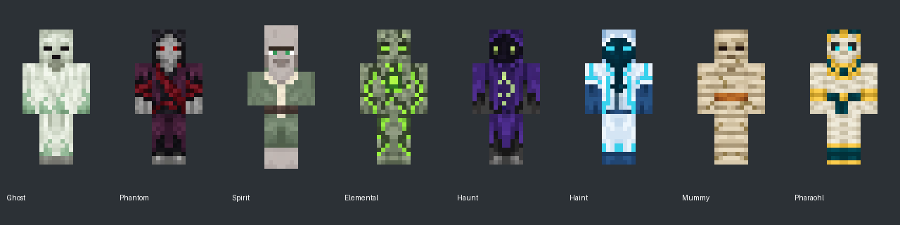

# Distinct mob appearances

Eight formerly shared/base skins now have original simple 64x64 textures, generated with the built-in image-generation tool and exported onto native UV islands. Existing humanoid/villager geometry is reused.

| Mob | Appearance | Existing rendering |
| --- | --- | --- |
| Ghost | Pale sage/mint burial shroud matching Ghost Garb, hollow dark eyes, richer mint hem | Intangible/translucent |
| Phantom | Dark plum coat, gray mask, red eyes and sash | Tangible/opaque |
| Spirit | Ash-gray villager skin, mint eyes, sage clothes and ivory trim | Villager model, intangible/translucent |
| Elemental | Moss-gray stone with lime cracks and chest core | Intangible/translucent |
| Haunt | Purple hood, dark face, green eyes and broken-ring sigil | Intangible/translucent |
| Haint | Icy white/cyan hood and dark teal face/sigil | Intangible/translucent |
| Mummy | Tan/ivory wraps, dark eye slits and faded ochre belt | Tangible/opaque |
| Pharaohl | Gold/teal headdress and collar, bone face and ivory wrappings | Existing tangible/intangible phase switch |

Assets: `src/main/resources/assets/mortal_expansion/textures/entity/<mob>.png` for the eight names above. Mortal Golem already has four dedicated flesh-tier skins, which remain in use. Vanilla Ghast variants and the render-only Haunt shadow are unchanged.

`SpectralMobRenderer` replaces the placeholder-named renderer without changing its model geometry, pose, hover, shadow rules or 20% spectral alpha. The Spirit retains its villager model, age scaling and 20% alpha. Only texture selection changes. No AI, spawning, hitboxes, damage, trades, loot or saved IDs change; the Pharaohl still delegates translucency to its existing phase predicate.

## Preview and validation

This diagnostic assembles front UV faces at full opacity to inspect alignment and distinctness. It is not a gameplay screenshot or a simulation of final spectral visibility/lighting. The Spirit is displayed flat here; its in-game folded-arm villager pose and nose are retained.

Generated masters were exported using nearest-neighbor sampling to 64x64. The original vanilla texture alpha masks are layout templates only; unused UV regions are cleared and occupied texels are opaque so the renderer alone controls intangibility opacity. Native geometry/UV use reduces version-sensitive custom rendering. No new shader, model layer, mixin or data format is introduced.

The update is verified by build, source-reference and texture/alpha/layout checks. Actual in-game lighting, translucency and animation remain client playtest checks.

## Generated masters and prompts

Masters live under `C:/Users/scott/.codex/generated_images/01a10808-7c57-7922-a619-5f19e36de671/`. Individual filenames and final prompts:

### ghost

Master: `exec-5e93bfd5-2185-4a62-8862-077fa2cddbd3.png`.

Use case: precise-object-edit. Asset type: production Minecraft mob UV texture atlas, NOT a character illustration. The reference is the actual vanilla zombie 64x64 texture enlarged nearest neighbor. Preserve EXACT UV island positions and occupied area: head unwrap in upper-left (head face pixels x8..15,y8..15), torso at x16..39,y16..31, arm at x40..55,y16..31, legs at x0..15,y16..31. Retain transparent unused background and unused lower half; no rearranging, no inset or margin, no labels. Paint the entire used UV islands with simple Minecraft pixel art, coarse pixels on the original64x64 logical grid, flat material colors with just 2-3 shades per material. Head/torso/limb surfaces need matching edges. Replace the zombie's green face and turquoise clothes completely. An original Ghost: ash-white burial shroud over pale gray skin, two deep charcoal eye slits, small dark hollow mouth, pale green wisps stitched into lower torso hem. No armor, no zombie decay, no elaborate decoration. Simple white/gray dominant with sparse mint accents, readable at distance. Genuine alpha transparency outside UV islands. No lighting effects, bloom, perspective or cast shadows.

### phantom

Master: `exec-cc7ecd1d-cafd-4c03-a3f0-e9d0f62cf21c.png`.

Use case: precise-object-edit. Asset type: production Minecraft mob UV texture atlas, NOT a character illustration. The reference is the actual vanilla zombie 64x64 texture enlarged nearest neighbor. Preserve EXACT UV island positions and occupied area: head unwrap in upper-left (head face pixels x8..15,y8..15), torso at x16..39,y16..31, arm at x40..55,y16..31, legs at x0..15,y16..31. Retain transparent unused background and unused lower half; no rearranging, no inset or margin, no labels. Paint the entire used UV islands with simple Minecraft pixel art, coarse pixels on the original64x64 logical grid, flat material colors with just 2-3 shades per material. Head/torso/limb surfaces need matching edges. Replace the zombie's green face and turquoise clothes completely. An original tangible empowered Phantom: charcoal-black hood and worn dark plum coat, pale gray mask-like face with two narrow red eyes, simple dark red sash across torso and forearms, ash-gray hands. Broad recognizable dark silhouette, sparse red highlights, no elaborate armor. Genuine alpha transparency outside UV islands. No lighting effects, bloom, perspective or cast shadows.

### spirit

Master: `exec-46130315-a955-4db6-8770-3dc7b6fb386b.png`.

Use case: precise-object-edit. Asset type: Minecraft VILLAGER native UV skin atlas, not a character picture. The attached reference is the actual vanilla villager 64x64 texture enlarged. Preserve exact UV positions, scale and transparent unused space, including villager nose, long robe and folded-arms texture areas. No rearranging or new margins. Create an original peaceful Spirit Villager: retain recognizable villager face layout, large nose, folded arms and robe, recolor skin to pale cool ash-gray, no bald-head brown tones, two soft mint-green eyes with dark simple eyebrows, muted sage-green long robe with a single ivory vertical center trim and a plain dark brown belt. Sleeves match robe, hands pale gray, boots charcoal. Very simple coarse pixel art at the native64x64 logical resolution, 2-3 shades per material, flat front-facing UV map, no rendered character or perspective, no glow bloom. No zombie motifs, no skull mask, no extra clothing emblems. Genuine transparent background outside native islands.

### elemental

Master: `exec-92586504-cbce-4bc4-bfec-3f25a3cea9b8.png`.

Use case: precise-object-edit. Asset type: Minecraft native mob UV texture atlas, NOT an illustration of the mob. Reference image is the vanilla 64x64 zombie atlas enlarged nearest-neighbor. Preserve EXACT location and size of every original UV island, and transparent unused region including lower half. Face is logicalpixels x8..15 y8..15; body x16..39 y16..31; legs x0..15 y16..31; arms x40..55 y16..31. No adding margins, moving islands, perspective, labels or human drawings. Replace all zombie skin/clothing with original simple pixel-art materials at original64x64 logical pixel resolution. Flat surfaces, limited palettes, 2-3 shades per material, no gradients or bloom. An original spectral Elemental: simple mossy gray-green stone body, broad clearly drawn dark cracks on head torso and limbs filled with lime-green ectoplasm, two square bright green eyes in a plain stone face, a single brighter green square core on chest. No clothes, no zombie green flesh, no elaborate armor. Whole humanoid made of sturdy blocks of haunted gray stone.

### haunt

Master: `exec-6f611070-38d0-4d13-9a09-fe94006b3d15.png`.

Use case: precise-object-edit. Asset type: production Minecraft mob UV texture atlas, NOT a character illustration. The reference is the actual vanilla zombie 64x64 texture enlarged nearest neighbor. Preserve EXACT UV island positions and occupied area: head unwrap in upper-left (head face pixels x8..15,y8..15), torso at x16..39,y16..31, arm at x40..55,y16..31, legs at x0..15,y16..31. Retain transparent unused background and unused lower half; no rearranging, no inset or margin, no labels. Paint the entire used UV islands with simple Minecraft pixel art, coarse pixels on the original64x64 logical grid, flat material colors with just 2-3 shades per material. Head/torso/limb surfaces need matching edges. Replace the zombie's green face and turquoise clothes completely. An original Haunt: deep muted violet hood and hanging robe, near-black face within hood, two luminous lime-green square eyes, one simple pale green vertical broken-ring sigil on torso, ragged-looking charcoal hem painted onto leg surfaces. Purple black and green palette, minimal detail. Genuine alpha transparency outside UV islands. No lighting effects, bloom, perspective or cast shadows.

### haint

Master: `exec-91e8cd3f-5393-452b-814d-01af7bc439b1.png`.

Use case: precise-object-edit. Asset type: production Minecraft mob UV texture atlas, NOT a character illustration. The reference is the actual vanilla zombie 64x64 texture enlarged nearest neighbor. Preserve EXACT UV island positions and occupied area: head unwrap in upper-left (head face pixels x8..15,y8..15), torso at x16..39,y16..31, arm at x40..55,y16..31, legs at x0..15,y16..31. Retain transparent unused background and unused lower half; no rearranging, no inset or margin, no labels. Paint the entire used UV islands with simple Minecraft pixel art, coarse pixels on the original64x64 logical grid, flat material colors with just 2-3 shades per material. Head/torso/limb surfaces need matching edges. Replace the zombie's green face and turquoise clothes completely. An original Haint: icy white and pale blue hooded burial vestments, dark teal recessed face, bright cyan narrow eyes, one dark teal vertical sigil down torso flanked by simple cyan trim, dark blue hands and lower hem. A clean powerful purified spirit distinct from the purple Haunt. Minimal geometric decoration. Genuine alpha transparency outside UV islands. No lighting effects, bloom, perspective or cast shadows.

### mummy

Master: `exec-4f13a2e4-0b4e-4646-91fc-ea230908bb56.png`.

Use case: precise-object-edit. Asset type: Minecraft native mob UV texture atlas, NOT an illustration of the mob. Reference image is the vanilla 64x64 zombie atlas enlarged nearest-neighbor. Preserve EXACT location and size of every original UV island, and transparent unused region including lower half. Face is logicalpixels x8..15 y8..15; body x16..39 y16..31; legs x0..15 y16..31; arms x40..55 y16..31. No adding margins, moving islands, perspective, labels or human drawings. Replace all zombie skin/clothing with original simple pixel-art materials at original64x64 logical pixel resolution. Flat surfaces, limited palettes, 2-3 shades per material, no gradients or bloom. An original Mummy: dusty ivory and tan cloth bandages running horizontally around every body part, very sparse olive brown aged stains and thin dark seams, two deep dark square eye holes peeking through the wrapped face, no visible mouth except a narrow slit, one simple faded dark orange belt at torso waist. Entire head torso arms legs wrapped in cloth. No zombie clothes, no gore, no jewelry, no detailed ornaments.

### pharaohl

Master: `exec-3a838b27-bc63-4625-8026-ecd3f251f8af.png`.

Use case: precise-object-edit. Asset type: Minecraft native mob UV texture atlas, NOT an illustration of the mob. Reference image is the vanilla 64x64 zombie atlas enlarged nearest-neighbor. Preserve EXACT location and size of every original UV island, and transparent unused region including lower half. Face is logicalpixels x8..15 y8..15; body x16..39 y16..31; legs x0..15 y16..31; arms x40..55 y16..31. No adding margins, moving islands, perspective, labels or human drawings. Replace all zombie skin/clothing with original simple pixel-art materials at original64x64 logical pixel resolution. Flat surfaces, limited palettes, 2-3 shades per material, no gradients or bloom. An original ancient Pharaohl: a gold-and-dark-teal striped royal nemes headcloth painted across all head faces, a pale sand-bone face with dark eye sockets and small cyan eyes, broad simple gold collar at torso neckline, ivory mummy wrappings across torso and limbs, a dark teal waist sash with one gold square buckle, gold wrist bands. Readable restrained gold teal ivory palette, no beard projecting outside UV, no elaborate armor, no extra model parts.

## Ghost palette refinement

The Ghost was subtly tinted sage/mint to match Ghost Garb; the native UV layout and alpha mask remain unchanged. Generated edit master: `exec-192f892f-1917-4bfd-8646-55a0ad2586f2.png` in the masters directory above. References: original Ghost master and `ghost_garb_woven_layer_1.png`.

Prompt: Precise recolor only; preserve the atlas canvas, UV islands, pixel grid, shroud pattern, dark face and transparency. Tint the pale shroud subtly muted sage/mint using Ghost Garb as palette reference, retaining desaturated spectral highlights and gray-green shadows. No armor shapes, new features, bloom or blur.
